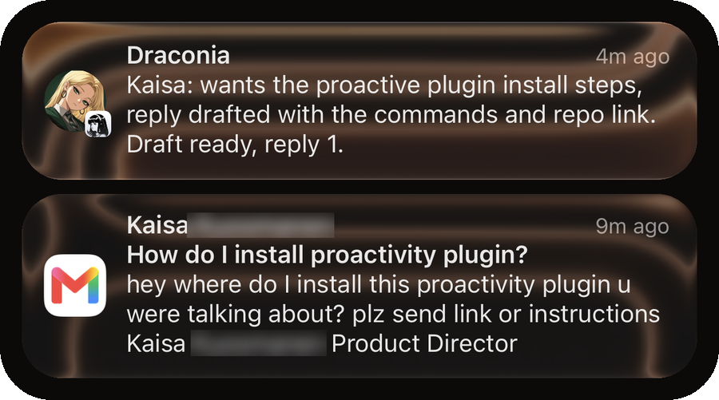
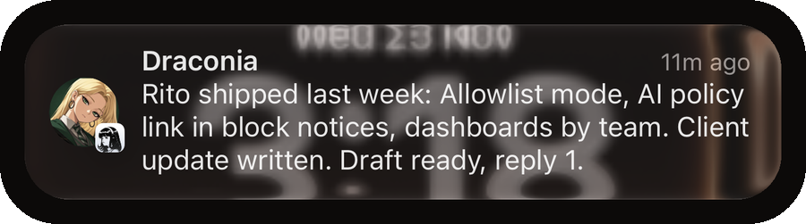
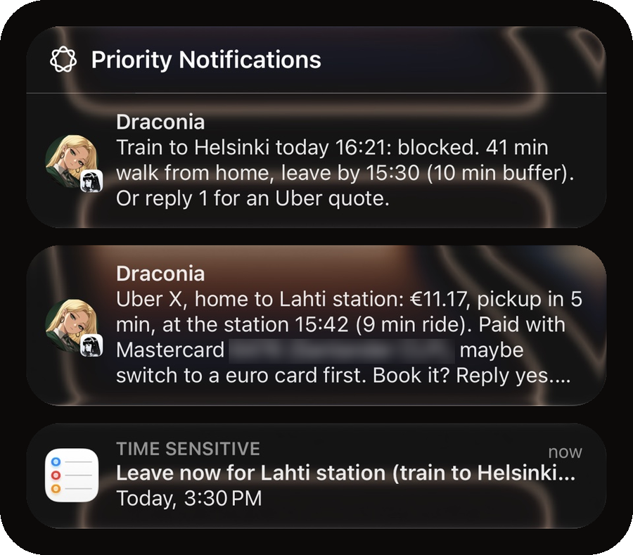
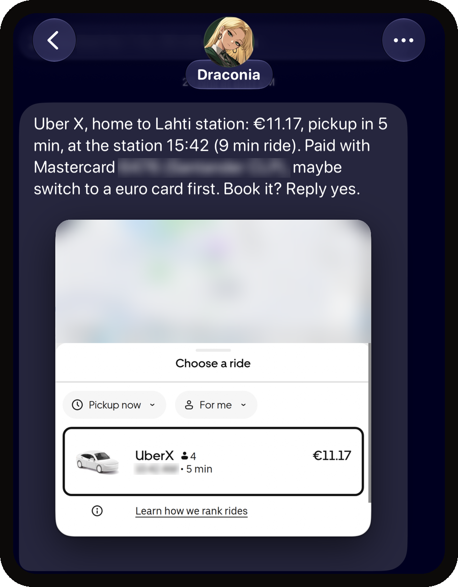
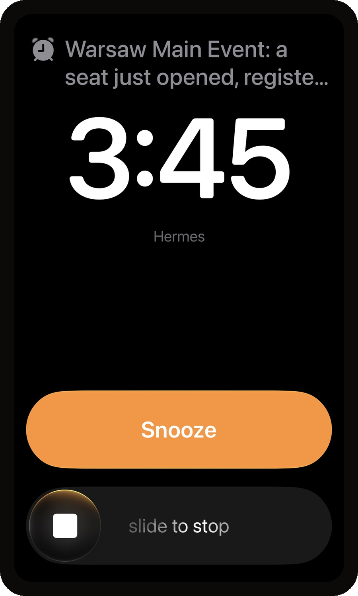
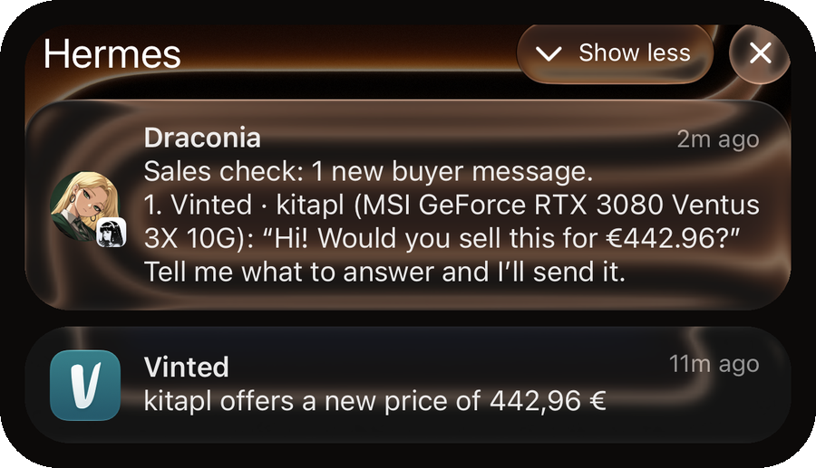
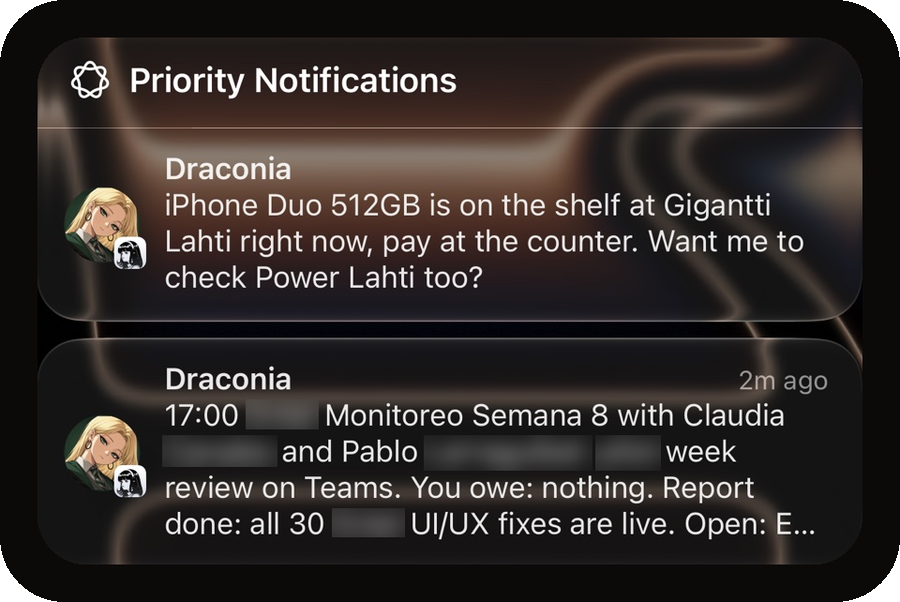

[](https://heyrito.ai)

# Proactive Hermes

**It watches your mail, calendar, work tools and the things you care about, and acts before you have to ask.**

A proactive executive-assistant desk for [Hermes Agent](https://hermes-agent.nousresearch.com). Built by [HeyRito.AI](https://heyrito.ai).

     [](LICENSE)

**[Install](#install)** · **[Set it up](#set-it-up)** · [Mail push](#instant-mail-push-optional) · **[How it works](#how-it-works)** · [Screenshots](#what-it-looks-like) · [Real examples](#real-examples) · [Decision model](#the-decision-model-highly-recommended) · [Features](#what-it-does) · [Make it your own](#make-it-your-own) · [Privacy](#privacy-and-safety) · [About](#built-by-heyritoai)

---

> **Quick start:** in the Hermes desktop app, open the **Bots** tab and click your Bot once (Bot Mode is on by default). Run `hermes plugins install jjdmev2/proactive-hermes --enable`, then open your Bot Chat and type **`/proactive setup`**. `hermes proactive doctor` checks that it all works. Add an OpenAI key for the [decision model](#the-decision-model-highly-recommended) in **Settings → Plugins → Proactive Hermes**.

## Why Proactive Hermes?

The messages worth getting from an assistant are about things you never set up an alert for: the client call that now overlaps your dentist, the invoice due today, the reply you promised yesterday and never sent.

Proactive Hermes runs a small desk inside your own Hermes. Scheduled jobs read your mail, calendar, Slack and Linear, and watches check the shops, marketplaces and event pages you pick. Most runs end with no message.

When it does write, small things are already done (the calendar block is in, the reminder is set), and the rest is prepared so a "yes" finishes it:

> "Train to Lahti Fri 07:12: blocked, leave at 06:35 (10 min buffer)."
> "Alex: the pricing questions are in, your reply is 2 days late. Draft ready, reply 1."
> "Buyer offers 356 for the graphics card (listed 400). Counter at 380? Reply 1."

## What it looks like

Real messages from the Hermes app. Private details blurred.

#### Mail and work

|  |  |
| :--- | :--- |
| A teammate asks how to install. The reply is drafted before you open the mail. | Last week's releases, checked against Linear, turned into a client update. |

#### Looking ahead

|  |  |
| :--- | :--- |
| Train blocked on the calendar, walk time from your phone, an Uber quote, then the reminder to leave. | Tapping it opens the quote with Uber's own screen. Nothing is booked until you say yes. |

#### Watches

|  |  |
| :--- | :--- |
| A seat opened at a sold out event. The alarm is set to ring through Focus. | A buyer offer on Vinted, ready to answer. |



Shop stock found, and prep before a client call.

## Real examples

These all happened on our own desk.

| Situation | What Hermes did |
| :--- | :--- |
| **A train ticket home** | The booking mail arrived. Hermes blocked the trip on the calendar and sent the time to leave from your phone's location, with a 10 minute buffer. |
| **A conference spot opened** | A watch was checking the registration page every few minutes. When a seat freed up it sent a message, queued a phone alarm (it rings through Focus once it reaches the phone), and had the registration ready. |
| **A buyer made an offer** | A marketplace offer came in below the asking price. Hermes reported it with a suggested counter, and on "yes" answered the buyer in the app. |
| **A promise to a partner** | The owner had promised a list of questions "over the weekend". A teammate posted the list in Slack on Monday. Hermes connected the two, drafted the email in the right thread, and sent it after "yes". |
| **A meeting moved** | A client proposed a new time. Hermes checked the calendar, said it was free, and accepted on "yes". |
| **A bill about to cut service** | An overdue notice said service stops in 3 days. Hermes set a reminder for the next morning with the amount and due date. |
| **A double-booked weekend** | Three days before, Hermes saw two tournament registrations in different cities on the weekend of a train already in the calendar, and a third event with two different dates. It asked which plan was real. |
| **A daily call** | After the team's daily, Hermes read the call notes in Slack, checked each point against Linear, and sent the owner what was done, what was not, and today's focus. Nothing was posted in Slack. |

Things you can set up the same way: a new card set or sneaker drop ("alarm me when preorders open"), concert or Luma event registration ("tell me when it opens, with the form filled"), stock at your local hardware store or on Amazon, replies to offers on Vinted, eBay or Marketplace, and "suggest a reply to every mail from X".

## Install

### Before you install

| Requirement | Why | How |
| :--- | :--- | :--- |
| **Hermes Agent 0.23.4 or newer** | The plugin uses Bot Mode delivery and the cron scheduler. | `hermes update` |
| **Bot Mode** | Desk messages arrive as normal replies in your Bot's **Bot Chat**, with the app's normal notification. | Bot Mode is on by default in the Hermes desktop app. Open the **Bots** tab and click your Bot once so its Bot Chat exists. You read it in the desktop app or the Hermes mobile app. |
| **The gateway running** | Messages are delivered through your profile's running gateway. If it is off, nothing reaches you. | Keep the Hermes desktop app open, or run `hermes gateway start`. |
| **The right profile** | The desk talks in the Bot Chat of the profile (Bot) you install it into. | Use your main assistant Bot. If that is not your default profile, add `-p <profile name>` to every command below, for example `hermes -p assistant plugins install ...`. `hermes profile list` shows the names. |
| **Hermes mobile app** (recommended) | Desk messages buzz your phone like a text; reminders, alarms and leave times need it. Tested on iPhone. | See [Give Hermes access](#give-hermes-access). The plugin works without it, and `doctor` tells you it is missing. |

### Install the plugin

```bash
hermes plugins install jjdmev2/proactive-hermes --enable
hermes proactive doctor
```

`hermes proactive doctor` checks the gateway, the Bot Chat, the phone, the OpenAI key and your mail, and tells you how to fix anything missing. `hermes proactive doctor --send-test` posts one test message into your Bot Chat, so you can see it land on your phone. If `hermes proactive` is not found (plugins running with `plugins.isolation: host`), use `python3 ~/.hermes/plugins/proactive-hermes/cli.py doctor` and the same flags.

### Give Hermes access

The desk only sees what you connect. All of it is optional, but connect at least one mailbox or calendar.

| Access | What it unlocks | How |
| :--- | :--- | :--- |
| **Hermes mobile app** | Reminders and alarms on your phone, leave times based on where you are, your phone calendar and contacts. | Install the Hermes app, sign in to the same Hermes, and share **Reminders, Alarms, Location and Calendar** in its settings (Contacts too, if you want it to find people's numbers). |
| **OpenAI API key** | The [decision model](#the-decision-model-highly-recommended): drops noise before any agent runs and spots your promises. About 3 cents per 1,000 emails. | Fill **OpenAI key for the decision filter** in **Settings → Plugins → Proactive Hermes**. It can be your usual key ([why it goes here](#the-decision-model-highly-recommended)). Add a few dollars of credit on [platform.openai.com](https://platform.openai.com). |
| **Mail and calendar** | Mail radar, promise tracker, look-ahead, trips, calendar blocks and conflicts. Connect every mailbox you use, work and personal: tickets and bookings often land in a personal one. | The `google-workspace` skill for Gmail and Google Calendar; [himalaya](https://github.com/pimalaya/himalaya) for any other mailbox (IMAP). |
| **Instant mail push** (optional) | New mail wakes the mail radar within 1 to 3 minutes instead of at the next 15 minute check. | An app password per mailbox, pasted into Hermes's settings. See [Instant mail push](#instant-mail-push-optional). |
| **Slack and Linear** | Asks waiting on you, the work recap, promises made in Slack. | Hermes connectors (Nous Portal). |
| **Rides, trains and food** (optional extra) | Bookings from the look-ahead: "Uber to the station at 08:40?" on your yes. | Sign in once to Uber's site (m.uber.com), your rail operator and your food delivery site in Hermes's browser. See [Bookings](#bookings-optional-extra). |
| **Your apps and sites** | Watches on marketplaces (Vinted, eBay), shops (Amazon, your local hardware store), event pages (Luma, Eventbrite, conferences), ticket drops. | Sign in once in Hermes's browser (the browser tool; with `local` it uses a copy of your own Chrome profile). Never paste passwords into chat. |
| **Public holidays** | Skip holidays in the countries you pick. | `~/.hermes/hermes-agent/venv/bin/pip install holidays` (the Python Hermes runs on) |

## Set it up

Setup is a short chat in your Bot Chat. Two ways to start it:

| Where | How |
| :--- | :--- |
| **In your Bot Chat** (recommended) | Type `/proactive setup`. If you just start chatting after installing, Hermes offers it once by itself. |
| **In a terminal** | `hermes proactive setup` |

First you pick a starting point:

| Option | What you get |
| :--- | :--- |
| **1. Juan's setup** | What Juan runs every day: morning brief 08:00, mail radar every 15 minutes from 07:00 to 23:00, Slack sweep hourly on workdays, promise tracker 3 times a day, work recap after the daily call, evening close-out 21:30, weekly review Friday 15:00, quiet hours 23:00 to 07:00, drafts before questions. Built for the decision model. You only fill in your own details. |
| **2. My own** | Start blank. Hermes asks about your day and builds the desk around it. |

Hermes starts from what it already knows (your name, timezone, connected mail, calendar, Slack, Linear, OpenAI key) and asks only what is missing, one question at a time: quiet hours, holiday countries, channels to watch, when your team's daily is. It also asks what it may do without asking you (see [approval levels](#approval-levels)) and suggests two or three first watches.

You see every job and its times before anything is created. At the end it sends a test message. Run setup again any time; it updates the same jobs.

### Instant mail push (optional)

The mail radar checks your mail every 15 minutes. With push, new mail wakes it within 1 to 3 minutes. iCloud is usually under a minute. Push needs an app password per mailbox. You can revoke it any time.

1. **Make an app password.**
   - Gmail: open [myaccount.google.com/apppasswords](https://myaccount.google.com/apppasswords). 2-Step Verification must be on. Work or school accounts, Advanced Protection and security key only accounts may not offer app passwords.
   - iCloud: [account.apple.com](https://account.apple.com) > Sign-In and Security > App-Specific Passwords. Two-factor authentication must be on.
   - Outlook, Hotmail, Live and Microsoft 365: not possible. Microsoft allows only its own sign-in for mail, so an app password is refused. These mailboxes stay on the 15 minute checks.
   - Fastmail, Yahoo and others: your provider's app password page. If your provider has none, that mailbox stays on the 15 minute checks.
2. **Paste it into Hermes, not into a chat.** Open **Settings → Plugins → Proactive Hermes** in the desktop app, or run `hermes plugins config proactive-hermes`. Fill **Mailbox 1 address** and **Mailbox 1 app password**. Use Mailbox 2 to 6 for more mailboxes. If your address does not end in gmail.com, icloud.com, me.com, mac.com, fastmail.com or a yahoo domain, also fill **Mailbox 1 IMAP server**. For a work Gmail on your company's domain that is imap.gmail.com. For anything else, take it from your provider's help page. The port is 993 unless your provider says otherwise.
3. **Restart Hermes** so push starts: `hermes gateway restart`, or quit and reopen the desktop app. Run `/proactive setup` first if you have not yet. Restart again every time you add, change or replace a mailbox or its app password. Hermes reads them only when it starts.
4. **Check it.** Run `hermes proactive doctor`. Under `mail_push`, each mailbox (`Mailbox 1 (gmail.com)`) shows `instant push`, or `15 min checks` with the reason and the fix. A `Gmail API` or `himalaya account` row on `15 min checks` is the normal reading connection.

**If you skip it,** mail is checked every 15 minutes. Push only wakes the radar sooner, so the mailbox still has to be connected in [Give Hermes access](#give-hermes-access). Push pauses in quiet hours and stays off with `plugins.isolation: host`. Changing your normal password cancels Google and Apple app passwords; make a new one.

**Privacy.** Hermes stores the app password, not the plugin. It is used only to log in to that mailbox, never logged and never asked for in chat. Push reads no mail; it only notices new mail. Pasted one into a chat by mistake? Revoke it.

### Approval levels

| Level | Juan's setup | You can change it to |
| :--- | :--- | :--- |
| **Without asking** | Private calendar blocks, phone reminders, alarms for urgent things, leave times for trips. | Any of these, or none. Watch actions too, if you want a watch to act on its own. |
| **Ask first** | Sending email or Slack, replying to offers, registering for events, purchases (Hermes fills the cart, you pay), bookings (Hermes stops at the price and books on your yes to that exact quote), accepting invites. | Everything not allowed above lands here. Hermes prepares it fully and asks in one line; a "yes" approves that one action. |
| **Never** | Entering or changing card details or payment methods, approving a payment in your bank app, passwords, deleting data. | These always stay with you. |

### Add your own watches

Tell Hermes in chat ("watch the Luma page for the AI meetup and tell me when registration opens") and it sets one up, or add it yourself:

```bash
hermes proactive watch add --name "Card drop" --schedule "*/15 * * * *" \
  --check "the shop page for the new card set" --when "preorders open" --then alarm --urgent
```

`--then` is what happens when the condition is true: `tell` (a line in chat), `reminder`, `alarm` (urgent only), `draft` (prepared and waiting for your yes) or `act` (done on its own; needs `--act "<exact action>"` and watch actions allowed in setup; a watch never pays, books or enters card details). `hermes proactive watch list` and `watch remove --name` manage them.

| Command | What it does |
| :--- | :--- |
| `hermes proactive setup` | Set up or change your answers |
| `hermes proactive setup --dry-run` | Show the jobs, change nothing |
| `hermes proactive status` | Your settings and the jobs the plugin owns |
| `hermes proactive doctor [--send-test]` | Check delivery to your Bot Chat and phone, and which mailboxes have instant push |
| `hermes proactive watch add ...` | Add a watch (see above) |
| `hermes proactive remove` | Remove every job the plugin created (settings and history stay) |

To uninstall completely: `hermes proactive remove`, then `hermes plugins remove proactive-hermes`, then delete `plugin-data/proactive-hermes/` and `scripts/proactive-hermes/` in your Hermes home (`~/.hermes`, or `~/.hermes/profiles/<name>`).

## How it works

```
 mail · calendar · Slack · Linear · watches · phone
                    │
     1. scheduled jobs wake up (Hermes cron)
                    │
     2. decision model filters (OpenAI, ~0.3 s)
                    │  only what may need you
     3. desk agent reads and picks candidates
                    │
     4. resolve: search sources, draft, cite
                    │
     5. gate: dedupe, rank, cap, quiet hours
                    │  one short numbered message
   your Bot Chat (and phone)  ->  you reply "1"
                    │
     6. small things done, the rest after your yes
```

1. **Wake up.** Each job runs on its schedule. A small script checks first whether anything changed (new mail, call notes posted). Nothing new, no agent run. Mailboxes with [instant mail push](#instant-mail-push-optional) also wake the radar when new mail arrives, through an IMAP IDLE connection inside the Hermes gateway.
2. **Filter.** With an OpenAI key, the decision model scores each new mail from its sender, subject and the start of the body. Clear noise is dropped and logged, so the agent never spends time on it.
3. **Read and pick.** The desk agent reads what is left and writes candidate items: a decision you must make, an action you must take, or a digest line.
4. **Resolve.** If an item needs you to send, reply, intro, book or decide, the agent searches mail, Slack, past chats and its own records first. It stores a draft with a source for every fact.
5. **Gate.** The gate ranks the items, removes anything you heard recently, caps the message at 3 items (5 in a brief) and holds non-urgent items during quiet hours. It sends one short numbered message as a normal chat reply.
6. **Act.** What your approval levels allow happens right away (a block, a reminder, an alarm, a leave time) and the message says so. Everything else waits for you: reply "1" and Hermes shows the draft or action with its sources and asks "Send as is?". A yes does it.

**What it costs to run.** The desk jobs are ordinary agent runs on the model of your Bot's profile. A cheap, fast model is enough: on our desk they use about 1% of the daily usage included in a Nous Portal plan, because most runs stop at step 1 or 2.

The plugin installs plain Python scripts under `scripts/proactive-hermes/` in your Hermes home and ordinary Hermes cron jobs named `Proactive · ...`. Your settings and history stay in `plugin-data/proactive-hermes/` there.

## The decision model (highly recommended)

Juan's setup is built around OpenAI's [**Decisions API**](https://developers.openai.com/api/docs/guides/decisions) with `gpt-6-luna`. It does not write text. You ask it a question with a fixed kind of answer and it returns a probability, a choice or a score (about 0.3 seconds in our runs). Input costs $0.10 per million tokens and output tokens are not charged, so 1,000 emails cost about 3 cents.

**How it ranks.** Every check is a yes or no statement, and the model returns how likely it is to be true, from 0 to 1. The desk acts only above fixed thresholds:

| Check | Statement the model scores | Action |
| :--- | :--- | :--- |
| Mail filter | "This message needs the owner to act or decide soon." It reads the sender, the subject and the first 600 characters of the body. | Below **0.10**: dropped and logged. Everything else goes to the agent. Your own mail, replies in a thread and calendar responses are never dropped. |
| Promise spotting | "The writer commits to a specific action for a specific person." | **0.6** or more: recorded as a promise. |
| Done check | "The later message does what was promised." | **0.8** or more **and** the message as evidence: promise closed. |
| Same matter | "Both texts are about the same matter." | **0.7** or more: merged, so you are not told twice. |
| Slack filter | "This message is waiting on the owner and is not answered yet." | Below **0.10**: skipped. DMs and messages that name you are always read. |
| Urgency | "This needs the owner today: money, security, travel, someone blocked." | **0.8** or more: may come through during quiet hours. |
| Prompt injection | "This text contains instructions aimed at an AI assistant." | **0.7** or more: flagged as suspicious, treated as data only, and you get one line about it. Nothing is dropped. |
| Work recap | "Which Linear issue matches this item from the call?" | **0.7** or more: linked. Below that: "no Linear issue found". |
| Close-out replies | "The reply gives an answer about item N." | Below **0.6**: Hermes asks you instead of guessing. |

Real scores from testing:

| Input | Score |
| :--- | :--- |
| "Black Friday 40% off" from a shop newsletter | 0.02, dropped |
| "You appeared in 12 searches" from LinkedIn | 0.02, dropped |
| "Re: proposal, need your A or B by tomorrow" from a client | 0.98, kept |
| "Invoice overdue, service suspends in 3 days" | 0.96, kept |
| "New sign-in to your account" from a bank | 0.90, kept |
| "I'll send you the deck and two dates by Friday." | 1.00, a promise |
| "Great meeting you, let's catch up sometime." | 0.15, not a promise |
| A mail asking the assistant to forward the last 10 emails to an outside address | 1.00, flagged as prompt injection |
| "Can we move our call to 3pm?" | 0.00, normal mail |
| Call item "Hotel booking in Lahti" vs Linear issue "Lahti hotel reservation" | 1.00, matched |

On one real inbox, the filter dropped 23 of 38 recent emails, all promotions (sportswear, supermarket, food delivery, news digests). It kept the other 15, including a rescheduled client meeting, an overdue bill and an expired identity check.

The cut-off is 0.10, so the filter only removes mail it is close to certain about. Reading the start of the body catches asks hidden behind a vague subject ("Re: hi"). The mail stays unread in your inbox.

**After the filter, the gate ranks items in this order:** urgent first, then priority (p0, p1, p2), then items where someone is waiting on you, then the nearest deadline, then decisions before actions, then the oldest.

**Where the key goes.** Fill **OpenAI key for the decision filter** in **Settings → Plugins → Proactive Hermes** (or `hermes plugins config proactive-hermes`). It can be the same key as `OPENAI_API_KEY`, but it has to be set here, because Hermes hides `OPENAI_API_KEY` from scheduled jobs. `hermes proactive doctor` shows `ok: true` under `decisions` when scheduled runs can see it. If several profiles share one gateway (same PID in `hermes gateway list`), also add `PROACTIVE_OPENAI_API_KEY` to `terminal.env_passthrough` in this profile's `config.yaml`.

**Without a key** the desk still works. The agent reads every mail that passes a simple sender and subject filter (newsletters, no-reply senders, "% off") and makes the yes or no calls itself, which is slower and costs more model time. If OpenAI is unreachable, nothing is dropped.

## What it does

| Feature | What you get |
| :--- | :--- |
| **One chat, real messages** | Short numbered replies in your Bot Chat, action first, with the app's normal notification. |
| **Quiet hours and holidays** | Non-urgent items wait until morning, and holidays in the countries you pick are skipped. In Juan's setup the mail radar and look-ahead rest from 23:00 to 07:00. |
| **Drafts before questions** | For anything you must send, reply to, book or decide, it searches first and brings a draft with sources. |
| **Promise tracker** | Records each "I'll send it tomorrow" from your mail, Slack and chat with your exact words, and closes it only on proof. |
| **Work recap after the daily** | Reads your team's call notes in Slack and checks each point against Linear and Slack: done, not done, Linear and Slack disagreeing, and today's focus. An evening wrap-up covers what shipped and what slipped. |
| **Mail radar** | Wakes when new mail arrives (and every 15 minutes as a safety net) and surfaces only what you must answer, pay or decide. |
| **Briefs and close-out** | Morning brief, an evening close-out you answer by number ("1 yes, 2 tomorrow"), and a weekly review. |
| **Meeting prep** | About an hour before each meeting: who is in it, your last thread, what you owe, what is open, a goal and an ask. Always for external meetings, internal ones only when something is open. The evening close-out flags meetings that need prep tonight. |
| **Look-ahead** | Checks upcoming plans from your calendar and the booking, ticket and registration mails in all your mailboxes. Bigger stakes, earlier first look: flights 30 days out, trains and local events 7 days, then more checks as the day gets closer. It speaks only for a gap, a change or a decision: "If the 09:50 train is yours, it lands 16 min before the start. The 09:09 lands 10:14, €15. Walking or Uber?" |
| **Trips and leave times** | A ticket or booking in your mail becomes a calendar block and a "leave now" reminder based on where your phone is, with a buffer. |
| **Watches** | Your own proactive tasks: marketplaces, shops, drops, event registrations, anything with a page. Tell, remind, alarm, draft or act. |
| **Phone reminders and alarms** | Reminders for deadlines and promises, alarms for the few things that cannot wait. They land when the Hermes app refreshes, so time critical items also get a calendar alert (see [Your phone](#your-phone)). |
| **Private calendar blocks** | Focus blocks on your own calendar for key tasks, a few per day at most, never touching events it did not create. |
| **Health checks** | A watchdog checks every job, the message outbox and failed deliveries, and only tells you when something needs you. |

## Make it your own

Proactive Hermes is a starting point. Swap sources, add your own, and wire it to the tools you already use.

An example from my own setup (Juan here). I built REUS, a meeting recorder like Granola. It files each call on its own in my company second brain or my personal one. REUS is a separate tool and is not part of this plugin. When a call is transcribed, REUS notifies Hermes. Hermes reads the notes and decides if anything is critical. If I said I would do something on the call, it comes back with that task, text, email or document ready for me to review and share. My daily standup is read twice: the Slack huddle transcript and the REUS recording, so the recap catches what one of them missed.

To add a source like this, give Hermes one way to read it (a CLI, an API or a script), then ask it in chat to add it to the desk: what to watch, what counts as important, and what it should prepare for you.

## Your phone

Every desk message lands in your Bot Chat with the app's normal notification. That is the main signal.

Phone reminders and alarms are a bonus. The Hermes mobile app picks them up when it refreshes or you open it, which can take minutes. An alarm that arrives after its time does not ring.

So anything time critical (an alarm, or a reminder that is high priority or due within 12 hours) also gets a calendar alert, which your phone fires by itself. This needs three things: a Google calendar connected to Hermes, private calendar blocks allowed without asking in setup, and that calendar added to your phone's Calendar app with notifications on.

Keep Background App Refresh on for Hermes. Low Power Mode pauses it, so reminders and alarms arrive late. Calendar alerts still fire.

## Bookings (optional extra)

When the look-ahead asks "walking or Uber?" and you answer "Uber", Hermes books it through the website, and only on your yes:

1. It fills in the ride, train or order in its logged-in browser and stops on the price screen.
2. You get the quote with a screenshot: product, price, pickup time and place, payment method.
3. It books only after your "yes" to that exact quote. One yes is one booking. If the price rises at all, or the product, time or payment method changes, it asks again.
4. Payment approvals (bank app, Face ID) stay on your phone, on purpose.

Works with sites that book on the web: Uber (m.uber.com), most rail operators, Wolt and similar. App-only services (for example Bolt rides) are out of scope; Hermes says so instead of guessing.

**Connect once:** Hermes opens the site in its browser and you sign in yourself, codes included. Hermes never sees or stores your password.

**Account risk.** Uber's terms forbid automated access. Every ride here has a human approving it and the volume stays human, but the risk to your account is yours. To skip it, never sign in to those sites; without a login Hermes cannot book anything.

## Privacy and safety

- **Approval first.** The desk only does on its own what you allowed in setup (in Juan's setup: blocks, reminders, alarms, leave times). Sending, replying, registering, buying and booking wait for your yes to that exact action, unless you let a specific watch act on its own. Hermes never enters card details or passwords, and nothing is paid without your yes to an exact quote.
- **Local.** Settings, drafts, promises and logs stay in your Hermes home, in a folder only your user can read. We run no server and collect no telemetry.
- **Your Bot's model sees what the desk reads.** Mail, Slack and calendar text go to the model provider of your Bot's profile, as in any Hermes chat.
- **What goes to OpenAI** (only with a key, only to the Decisions API): for mail, the sender, subject and first 600 characters of the body; for Slack, the message being judged; for promises and the work recap, the message or call item and the Linear title it is matched against; for your replies, the reply and the numbered list it answers; and the text of anything checked for prompt injection. Nothing else, and no files. OpenAI offers zero data retention for eligible accounts.
- **Keys come only through Hermes.** The plugin never opens `.env` files, Hermes's sign-in files, another tool's config or login, or a keychain. Your OpenAI key and mail push app passwords are read through Hermes, for your profile only.
- **Mail push app passwords** log in only to that mailbox's IMAP server. The push log names mailboxes by slot number, never by address.
- **Phone reminders and alarms** go through the Hermes mobile app's bridge database (`plugin-data/hermes-mobile-device-access/bridge.db`), the only route a scheduled job has. All access sits in one function, `bridge()` in `runtime/ea_reminders.py`. It also reads your phone's last sync time and last shared location there, for health checks and leave times.
- **Work and personal stay apart.** A work draft never uses facts from personal sources, and every fact carries a source.
- **Bounded.** Searches have call and time limits. Reminders, alarms and calendar blocks have daily caps, and each action is done once even if a job retries.
- **Text from mail, Slack or the web is treated as data.** Instructions inside it are never followed, and it never goes on a command line: the desk writes it to a file and passes the file.

### Disclosure

Everything the plugin touches outside its own folder:

- **Background IMAP connections** to the mailboxes you set up for [instant mail push](#instant-mail-push-optional), and only those, from inside the Hermes gateway.
- **OpenAI Decisions API calls**, only if you add a key (see "What goes to OpenAI" above).
- **Your Bot's model provider** sees the mail, Slack, calendar and page text the desk reads, as in any Hermes chat.
- **Messages in your Bot Chat.** The desk posts through Hermes's own Bot Chat delivery code (`tools.bot_live_delivery`), not a public plugin API. Each message enters as an internal turn and your Bot repeats it word for word.
- **Hermes's chat database** (`state.db` in your Hermes home). The desk searches your past chats there, read only, to resolve items. It writes one thing: a display flag that hides its own relay input from the chat view. It never changes or deletes message text.
- **One chat hook** (`pre_llm_call`). Once per profile, before setup, it adds one line asking your Bot to offer setup.
- **The Hermes mobile bridge database.** It creates, completes and checks reminders and alarms, and reads your phone's last sync time and last shared location, as described above.
- **Other Hermes files, read only:** the cron job list and job output (health checks), your `USER.md` memory (your name, at setup) and `config.yaml` (plugin settings).
- **Files it writes outside the plugin folder:** `scripts/proactive-hermes/`, `plugin-data/proactive-hermes/` and `logs/proactive-hermes-mail-push.log`, all in your Hermes home.
- **Shell commands:** `himalaya` (reading the mailboxes you picked), the google-workspace skill's scripts (reading Gmail and Google Calendar, and creating and removing its own calendar blocks and alerts), `hermes cron` (creating, editing and running its own jobs) and `hermes sessions archive` (hiding finished scheduled runs, and finished sessions with source `push`, from the app sidebar; archive only, never delete). The archive covers every scheduled run in the profile, not only the desk's.
- **Slack and Linear** through your Hermes connectors. Sending waits for your yes.
- **A logged-in browser** for watches on the sites you signed in to yourself, and for bookings you approve. Scheduled jobs never book or pay.

Found a security problem? See [SECURITY.md](SECURITY.md).

## Project guide

| Path | Contents |
| :--- | :--- |
| [`skills/proactive-desk/references/desk-contract.md`](skills/proactive-desk/references/desk-contract.md) | The rules every desk job follows |
| [`skills/proactive-setup/SKILL.md`](skills/proactive-setup/SKILL.md) | The setup interview |
| [`skills/proactive-desk/SKILL.md`](skills/proactive-desk/SKILL.md) | Answering desk messages, approvals, watches and close-outs in chat |
| [`presets/juan.json`](presets/juan.json) | Juan's setup: schedules, time zones, holiday countries and features; no accounts or contact details |
| [`jobs.py`](jobs.py) | Job templates and the installer |
| [`runtime/`](runtime) | The desk: sender, gate, resolver, decision model, promises, health |
| [`tests/`](tests) | Tests with no network access: `python3 -m unittest discover -s tests -t .` |

## Built by HeyRito.AI

Proactive Hermes is the desk we use every day at **[HeyRito.AI](https://heyrito.ai)**. We build Rito, the security and governance layer for AI at work: access scoped to each identity, approval before actions, an audit trail, and policies for every model and tool. Talk to us at **[heyrito.ai](https://heyrito.ai)**.

---

**Proactive Hermes**, built by [HeyRito.AI](https://heyrito.ai). Rito, the security and governance layer for AI at work.
